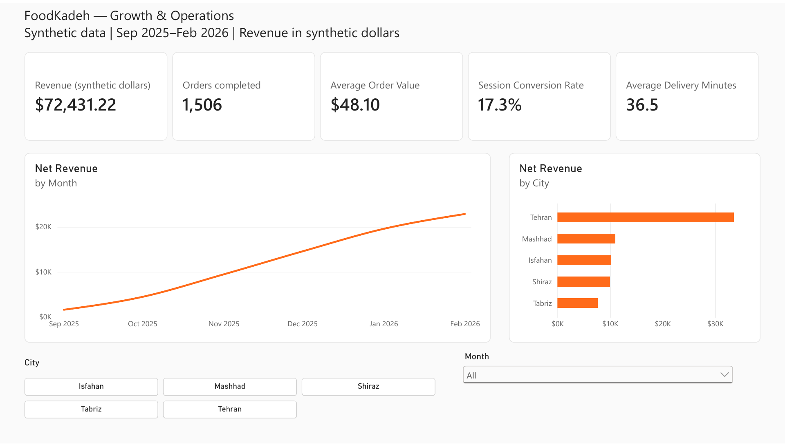

# FoodKadeh Data Analytics

A reproducible portfolio project combining Python, Jupyter, SQLite and Power BI for a **synthetic** food-commerce platform. All layers use seed 42 for **September 2025–February 2026**, with a customer snapshot of **1 March 2026**. Currency is synthetic dollars.

## Portfolio evidence

| Area | Implemented evidence | Skills demonstrated |
| --- | --- | --- |
| Python/Jupyter | [Executed notebook](FoodKadeh.ipynb), [shared generator](scripts/foodkadeh_data.py), [exporter](scripts/export_analytics.py) | Reproducible simulation, Pandas, visualization, feature engineering, clustering and classification |
| SQL | [SQLite views](sql/01_analytics.sql), [setup](sql/README.md) | CTEs, joins, conditional aggregation, LAG, NTILE, DENSE_RANK, RFM and cohorts |
| Power BI | [Seven-page PBIX](powerbi/FoodKadeh.pbix), [overview DAX](powerbi/service_measures.dax), [analysis DAX](powerbi/analysis_measures.dax), [guide](powerbi/README.md) | Weighted ratios, filter context, ALLSELECTED, cohort heatmaps, interactive filtering and dashboards |
| Validation | [Consistency checks](scripts/validate_consistency.py), [audit](CONSISTENCY_REVIEW.md) | SQL/Pandas reconciliation, source integrity and report structure checks |

[Open the report](https://app.powerbi.com/groups/me/reports/d5fdd6d6-bb09-4872-89b4-689fc58e3d96/d2c6f0a1907403c0de06?experience=power-bi) · [Open the Executive Dashboard](https://app.powerbi.com/groups/me/dashboards/53702303-d189-4853-8f9c-c1ea996a1ecc?experience=power-bi). Existing Power BI access is required; public sharing is disabled.

[](https://app.powerbi.com/groups/me/reports/d5fdd6d6-bb09-4872-89b4-689fc58e3d96/d2c6f0a1907403c0de06?experience=power-bi)

**Click the picture to open the interactive report.** This image is a clean Power BI export; filters work in the linked report and dashboard. Existing account access is required.

## Explore interactively

| Page | Controls and behavior |
| --- | --- |
| Overview | Select a city and month; KPI cards and both revenue charts update together |
| Acquisition | Device buttons filter channel conversion and the channel/device detail table; select a channel bar to explore its traffic |
| Customer value | Segment buttons filter buyer count, revenue, revenue per buyer, repeat buying and inactivity |
| Retention | Cohort buttons isolate first-purchase cohorts in the retention matrix |
| Products | Category buttons filter sales and units; category share recalculates within the selected categories |

Use the slicer's eraser/Clear selections control to restore all values; the report is saved with all filters cleared. Live dashboard tiles support their own page controls. Filters apply within each page's SQL snapshot, not across unrelated snapshot tables. The README picture is a static preview; GitHub Markdown does not host Power BI's interactive controls.

## Reconciled metrics

| Metric | Value | Definition |
| --- | ---: | --- |
| Registered users / products | 2,500 / 120 | Generated dimensions |
| Retained sessions | 9,838 | Post-signup sessions; 22,000 candidates exist before filtering |
| Converted sessions / all orders | 1,698 | Includes subsequent cancellations/refunds |
| Completed orders | 1,506 | Completed status only |
| Net revenue | $72,431.22 | Completed-order item revenue + delivery fee − discount |
| AOV | $48.10 | Net revenue / completed orders |
| Session conversion | 17.3% | 1,698 / 9,838 |
| Completed-order buyers | 1,047 | Distinct purchasing users |
| Repeat buyers | 335 (32.0%) | At least two completed orders / buyers |
| Non-repeat buyers | 712 (68.0%) | Exactly one completed order; not churn |
| Inactive over 45 days | 442 (42.2%) | Last completed purchase >45 days before snapshot |
| Product units | 3,899 | Quantity on completed orders |

Revenue is not commission or profit. Category sales use completed-order item revenue, excluding delivery fees and discounts. Session traffic source differs from user signup acquisition channel.

## Analysis and report coverage

The notebook covers KPIs, monthly sales, acquisition, SQL-aligned RFM, exploratory K-means, current inactivity classification, operations and first-purchase cohorts. RFM uses SQL NTILE with deterministic user-ID tie breaks and excludes never-buyers.

The Power BI report has **Overview**, **Monthly detail**, **City scorecard**, **Acquisition**, **Customer value**, **Retention**, and **Products** pages: 21 DAX measures and 18 visuals. Five disconnected SQL snapshots are embedded: MonthlyCity (30 rows), Acquisition (15), CustomerSegments (6), Retention (21), CategorySales (6). Overview city selection does not filter independent full-period snapshots. Ratios divide aggregated numerators by denominators.

The dashboard contains five live report-page tiles: overview, acquisition, retention, customer value and products. Saved report changes appear after dashboard refresh. Dashboard objects are not packaged in PBIX files.

The report uses static embedded snapshots, with no scheduled refresh. A full workbook was uploaded to OneDrive, but the report is **not connected to it**. The [Power BI guide](powerbi/README.md) separates the implemented report from the optional transaction-level model extension.

Direct [Power BI semantic-model verification](powerbi/validation/README.md) also passes: all 78 embedded rows/values, 39 measure/count/filter checks, and both selected-category sales/share rows match SQL. Captured results and read-only DAX queries are included. The comparator checks recorded evidence; it does not automate future live service queries.

## Reproduce

Use Python 3.12. Run from the repository root:

```bash
pip install -r requirements.txt
python scripts/export_analytics.py
python scripts/prepare_powerbi_extract.py
python scripts/prepare_powerbi_analysis.py
python scripts/validate_consistency.py
python scripts/validate_live_snapshot.py
```

Open `FoodKadeh.ipynb` in Jupyter and **Run All** from the repository root. Notebook and exporter import the same `scripts/foodkadeh_data.py` generator exactly once. The exporter recreates SQL views to apply definition changes. Generated CSVs/SQLite files are under ignored `data/`.

| Path | Purpose |
| --- | --- |
| FoodKadeh.ipynb | Executed analysis and charts |
| scripts/ | Canonical generation, exports, cross-layer validation |
| sql/ | SQL views and definitions |
| powerbi/ | PBIX, implemented DAX, themes, clean report-page exports and validation evidence |
| CONSISTENCY_REVIEW.md | Findings, fixes and verification limits |

Root `1.png`–`8.png` were regenerated from the executed notebook: KPI overview, sales trends, acquisition, RFM, K-means, current-inactivity classification, operations and cohorts. They are Python charts; Clean Power BI page exports are under `powerbi/previews/`; live-query evidence is under `powerbi/validation/`.

## Interpretation limits

- Synthetic trends do not establish campaign success, optimal pricing, product-market fit or causal delivery effects. No spend, costs or campaign calendar are generated.
- K-means labels differ from RFM segments; four clusters are an exploratory choice.
- The model classifies **current 45-day inactivity** with a random buyer holdout. Recency defines the label and is excluded from model inputs. This is not future-churn forecasting. Read regenerated output scores; historical fixed AUC claims are removed. A forecast needs an earlier feature cutoff, later outcome window and temporal evaluation.
- Gross margin, CAC, LTV and LTV/CAC are unavailable without COGS, marketing spend and future customer lifetime. Non-repeat buying is not inactivity or churn.
- Cohort Month 0 is 100%; observed inactive months are zero; future months are blank. Monthly cohorts cannot locate first-week dropout.
- Offers, checkout changes and delivery improvements are candidate experiments; their ROI and impact are not estimated here.

Educational prototype: replace synthetic inputs and extend the date grid/snapshot before applying it to real operations.
