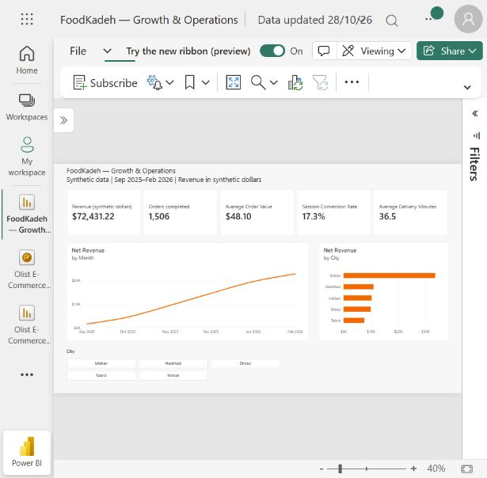
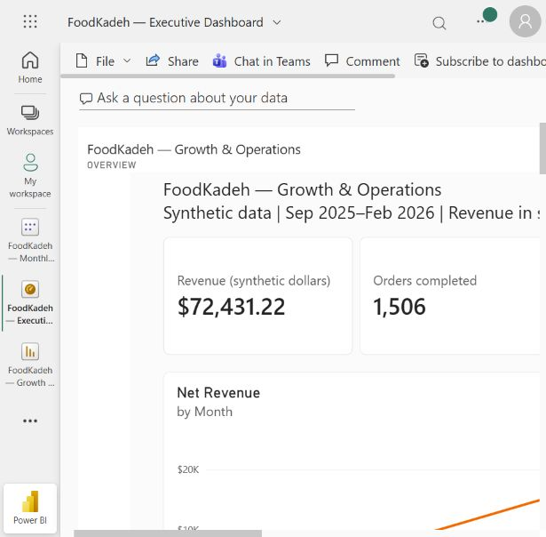
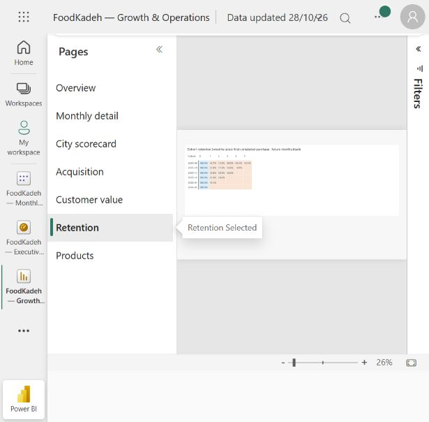

# Power BI analytics portfolio

The completed [FoodKadeh report with data](FoodKadeh.pbix) was built and saved in Power BI on 28 October 2026. Its seven pages cover Overview, Monthly detail, City scorecard, Acquisition, Customer value, Retention, and Products. [Open the service report](https://app.powerbi.com/groups/me/reports/d5fdd6d6-bb09-4872-89b4-689fc58e3d96/d2c6f0a1907403c0de06?experience=power-bi) or the [Executive Dashboard](https://app.powerbi.com/groups/me/dashboards/53702303-d189-4853-8f9c-c1ea996a1ecc?experience=power-bi) using existing account access. No public sharing was enabled.

## Implemented report and validation

The service model uses five disconnected SQL snapshots: `MonthlyCity` (30 rows), `Acquisition` (15), `Retention` (21), `CustomerSegments` (6), and `CategorySales` (6). Run `python scripts/export_analytics.py`, `python scripts/prepare_powerbi_extract.py`, and `python scripts/prepare_powerbi_analysis.py` from the repository root to reproduce the inputs. [Overview measures](service_measures.dax) and [analysis measures](analysis_measures.dax) contain the 21 DAX measures actually applied in the service. [Report theme](report_theme.json) supplies the orange palette. The downloaded `.pbix` passed ZIP integrity checks and contains seven HD pages, 13 visuals, and an embedded model.

The initial CSV/local Excel upload route was unavailable. `MonthlyCity` was loaded through Power Query direct entry; the four analysis snapshots were added through TMDL calculated `DATATABLE` partitions and refreshed successfully. The full generated workbook, `FoodKadeh_Analytics.xlsx`, was subsequently uploaded to the account's OneDrive after initialization. The report still uses the embedded SQL snapshots, not a connection to that workbook or the five full transaction tables. This is a static six-month snapshot; no scheduled refresh is configured.

| Implemented page | Contents |
| --- | --- |
| Overview | Five KPI cards, monthly revenue trend, city revenue bars, city selector |
| Monthly detail | Monthly revenue, completed orders, AOV, sessions, conversion and delivery metrics |
| City scorecard | City-level operating and commercial metrics |
| Acquisition | Channel conversion bar chart and channel/device sessions, conversions, weighted conversion table |
| Customer value | Six SQL RFM segments, buyers, revenue per buyer, repeat and inactivity rates; snapshot 1 March 2026 |
| Retention | First-purchase cohort/month matrix with background color scale; future months blank |
| Products | Category sales bars, product units and sales share; delivery fees and discounts excluded |

The Executive Dashboard contains five live report-page tiles: Overview, Acquisition, Retention, Customer value, and Products. Saved report changes appear when the dashboard refreshes. The dashboard is a service object and is not packaged inside the PBIX.

| Check | Python/SQL | Saved report |
| --- | ---: | ---: |
| Net revenue | 72,431.22 | $72,431.22 |
| Completed orders | 1,506 | 1,506 |
| AOV | 48.0951 | $48.10 |
| Retained sessions | 9,838 | 9,838 |
| Tehran revenue under city filter | 33,557.59 | $33,557.59 |
| Tehran completed orders under city filter | 730 | 730 |
| Tehran AOV under city filter | 45.9693 | $45.97 |

Session conversion includes orders later cancelled or refunded: 1,698 / 9,838 = 17.3%. Average delivery time is total completed-order delivery minutes divided by completed orders. Ratios are calculated from sums, not averaged across cities or months. The city filter was tested and cleared before saving. Customer value reconciles to 1,047 buyers, 335 repeat buyers (32.0%) and 442 buyers inactive over 45 days (42.2%). Cohort month zero is 100%; product units total 3,899. RFM uses SQL `NTILE` with deterministic user-ID tie breaks, so segments can differ from the notebook's `qcut` implementation. Each analysis page has its own grain; overview city filters do not filter the disconnected snapshot pages.

## Full transaction model extension

The remaining [DAX templates](measures.dax), [Power Query CSV loader](import_csv.pq), and [dark theme](theme.json) support building the fuller transaction-level model below in Desktop. These template assets are distinct from the service report implementation; they have not all been executed in Power BI.

## Build the model

1. Run `python scripts/export_analytics.py` from the repository root (see [SQL setup](../sql/README.md)).
2. In Power BI Desktop, import `users.csv`, `orders.csv`, `sessions.csv`, `products.csv`, and `order_items.csv` from `data/`. Name tables Users, Orders, Sessions, Products, and OrderItems. Use the reusable M function or Text/CSV import. Set IDs and quantity/converted to whole numbers, dates to Date, financial fields to fixed decimal, delivery time to decimal, and remaining fields to text. The M file contains a complete Orders invocation example.
3. Create one-to-many, single-direction relationships: Users[user_id] → Orders[user_id]; Users[user_id] → Sessions[user_id]; Orders[order_id] → OrderItems[order_id]; Products[product_id] → OrderItems[product_id]. Do not add a Sessions-to-Orders relationship: it creates a second filter path.
4. Create the Date calculated table from `measures.dax`, mark Date[Date] as its date column, and connect Date[Date] → Orders[order_date] and Date[Date] → Sessions[session_date]. Keep Users[signup_date] unrelated for this report. Add each measure separately; format money to 2 decimals and ratios as percentages.
5. Import `theme.json`. Label currency as synthetic dollars, matching the notebook; this is not a verified local-currency conversion.

## Report pages and interactions

| Page | Visuals | Business decision |
| --- | --- | --- |
| Executive overview | Net Revenue, Completed Orders, AOV, Repeat Purchase Rate cards; monthly revenue/orders trends | Monitor growth and repeat buying |
| Acquisition | Sessions and Session Conversion Rate by Sessions[traffic_source] and device | Compare traffic quality |
| Customer value | Import customer_rfm.csv as a separate snapshot table; segment counts and monetary value | Prioritize retention campaigns |
| Retention | Import cohort_retention.csv separately; matrix of cohort × month_index with retention_rate and conditional formatting | Identify early drop-off |
| Products and operations | Product Sales by category; Average Delivery Minutes and AOV by Users[city] | Compare category mix and delivery |

Use date and city slicers on transactional pages. Session traffic source differs from Users[acquisition_channel]; label them distinctly. A session-source slicer does not filter Orders in this model. Disable date/city slicer interactions on the two disconnected snapshot pages; title them “Full-period snapshot — through Feb 2026.” Use the SQL-exported retention rate without summing percentages; each matrix cell must contain exactly one cohort/month row. Future cells remain blank.

Product filters apply to OrderItems, so use Product Sales for category visuals. Net Revenue remains an order-level measure and must not be presented as category net revenue. Repeat Purchase Rate is calculated within the selected transaction period, not lifetime. MoM comparisons are intended for complete calendar months; suppress or clearly label partial-month comparisons.

## Validate before presenting

- Match the unfiltered Completed Orders and Net Revenue cards to exporter output and SQL monthly totals.
- Check a single month and city against a direct completed-order aggregation, then reset slicers.
- Check conversion numerator/denominator against channel_conversion.csv for a chosen source/device.
- Confirm cohort Month 0 is 100%, observed inactive months show 0%, and future months are blank.
- Confirm category Product Sales totals match SQL category_sales; compare with item revenue, not order net revenue.
- Check cross-filter behavior, empty selections, percentage formats, accessible contrast, and tooltip definitions.

The included `FoodKadeh.pbix` implements all seven pages using SQL snapshots. The full transaction-level relationships in this extension guide remain an optional extension.
