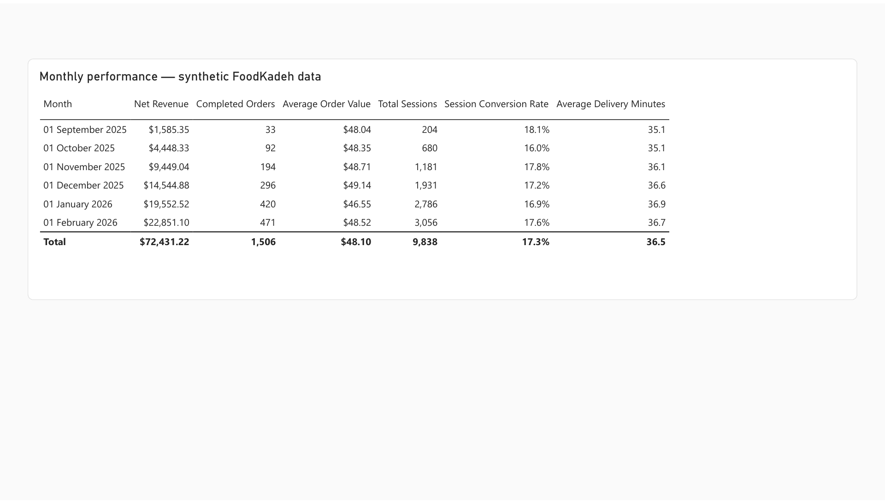
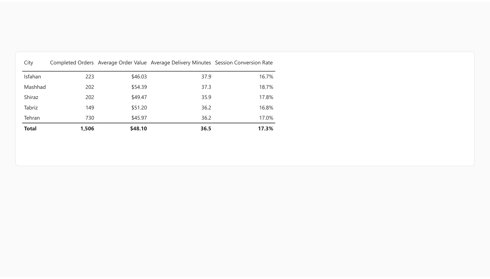
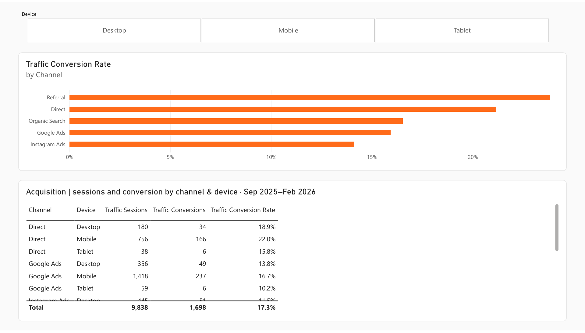
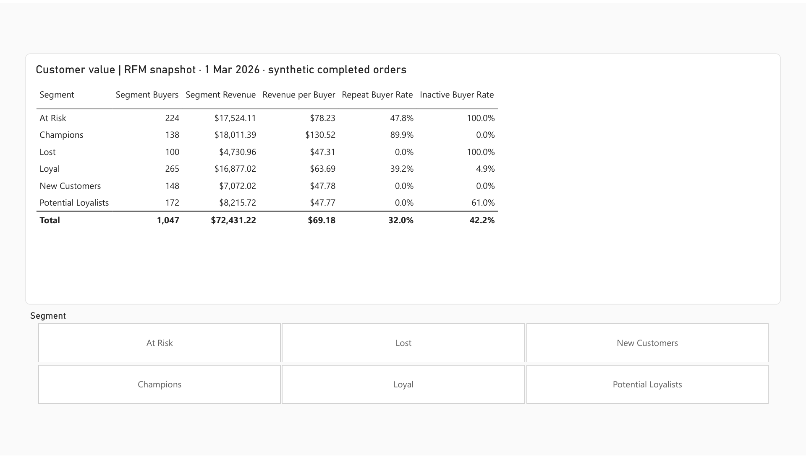
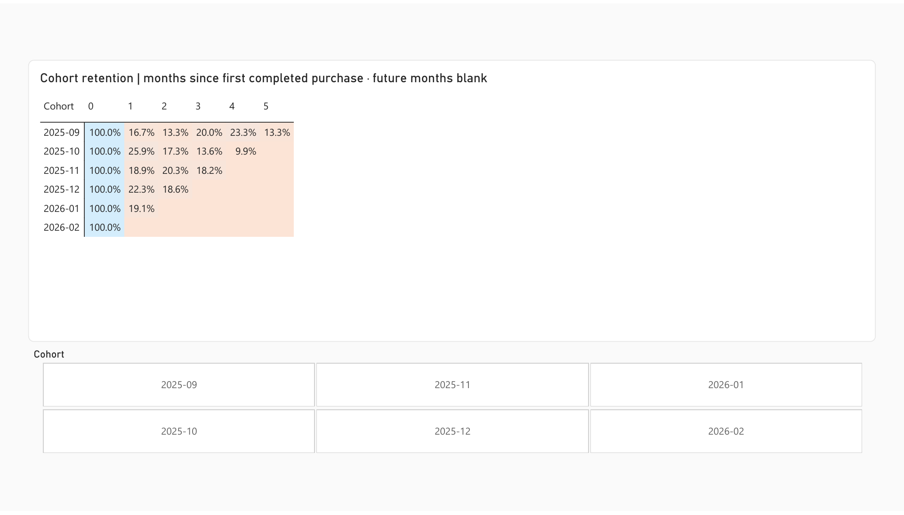
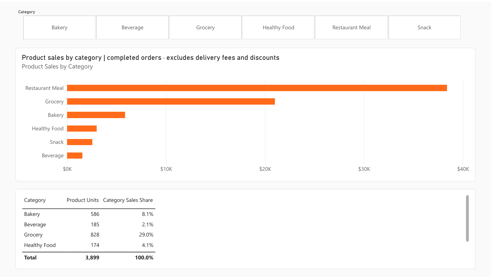

# Clean report pictures

These PNGs were rendered at 1920 pixels from Power BI's native seven-page PDF export on 28 October 2026, using default values with all slicers cleared. They show the report canvas without browser controls. Tables may show only the visible rows; open Power BI to scroll, filter and explore.

[Open the interactive report](https://app.powerbi.com/groups/me/reports/d5fdd6d6-bb09-4872-89b4-689fc58e3d96/d2c6f0a1907403c0de06?experience=power-bi) · [Open the live dashboard](https://app.powerbi.com/groups/me/dashboards/53702303-d189-4853-8f9c-c1ea996a1ecc?experience=power-bi). Existing account access is required. GitHub displays static pictures; the linked Power BI pages provide interactivity.

## Overview

## Monthly detail

## City scorecard

## Acquisition

## Customer value

## Retention

## Products

