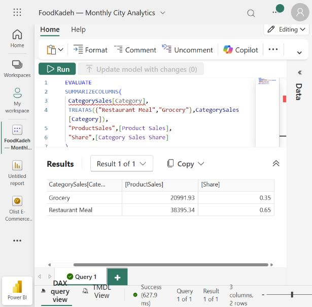

# Direct semantic-model verification — 28 October 2026

**PASS: all 78 embedded rows and numeric values match the regenerated SQL extracts; all 39 measure/count/filter checks and both selected-category sales/share rows pass.**

The queries were executed in the Power BI service's **DAX query view** against **FoodKadeh — Monthly City Analytics**, in **My workspace**, the semantic model used to build FoodKadeh — Growth & Operations.

- Workspace ID: `1dab85b5-c696-42fa-968e-e7c235d246d0`
- Semantic model ID: `92022f0d-a154-475f-9b7c-976f4b2ff976`
- [Open model query view](https://app.powerbi.com/groups/1dab85b5-c696-42fa-968e-e7c235d246d0/modeling/92022f0d-a154-475f-9b7c-976f4b2ff976/daxQueryView?experience=power-bi)
- Period: September 2025–February 2026; customer snapshot 1 March 2026.

The results were newly queried from the saved semantic model, then copied using the service's **Copy → Entire table** control. They are not values inferred from report screenshots. No model definition, report, source connection, refresh schedule or permission was changed, and no source refresh was requested.

## Full-row comparison

[01_snapshot_rows.dax](01_snapshot_rows.dax) returns all rows with a table/key and five numeric slots. Unused slots are zero. [live_snapshot_rows.tsv](live_snapshot_rows.tsv) contains all 78 returned rows, with no sampled or omitted rows. The comparator rejects duplicate keys or missing/extra rows and compares every numeric field with absolute tolerance `1e-9` and relative tolerance `1e-12`.

| Table | Rows | Key | A / B / C / D / E | SQL agreement |
| --- | ---: | --- | --- | --- |
| MonthlyCity | 30 | Month + City | NetRevenue / CompletedOrders / DeliveryMinutes / Sessions / ConvertedSessions | All match |
| Acquisition | 15 | Channel + Device | Sessions / Conversions / 0 / 0 / 0 | All match |
| Retention | 21 | Cohort + MonthIndex | CohortSize / ActiveBuyers / 0 / 0 / 0 | All match |
| CustomerSegments | 6 | Segment | Customers / Revenue / Orders / Inactive45 / RepeatBuyers | All match |
| CategorySales | 6 | Category | Units / Sales / 0 / 0 / 0 | All match |

## Measures and filter contexts

[02_measures.dax](02_measures.dax) evaluates all 21 implemented measures, five table counts and additional filter/blank checks. [live_measures.tsv](live_measures.tsv) stores the 39 returned checks. Numeric results use explicit `en-US` formatting; blank and display-text results are compared separately.

| Check | Live result | SQL agreement |
| --- | ---: | --- |
| Net Revenue / completed orders | 72,431.22 / 1,506 | Match |
| AOV / average completed delivery minutes | 48.0950996016 / 36.5452191235 | Match |
| Sessions / converted sessions | 9,838 / 1,698 | Match |
| Buyers / repeat-buyer rate / inactive-buyer rate | 1,047 / 31.9962% / 42.2159% | Match |
| Product Sales / units | 72,320.84 / 3,899 | Match; item sales exclude order fees/discounts |
| Tehran revenue / orders / AOV | 33,557.59 / 730 / 45.9693013699 | Match |
| Referral-Mobile conversion | 25.6730769231% | Match |
| Month-0 retention / pooled Month-1 retention | 100% / 20.6076618230% | Match |
| September cohort at Month 1 | 16.6666666667% | Match |
| Future February Month 1 / unscoped cohort total | Blank / blank | Match measure semantics |

[03_category_share.dax](03_category_share.dax) uses `SUMMARIZECOLUMNS` and a two-category `TREATAS` selection to reproduce visual grouping/filter context. [live_category_share.tsv](live_category_share.tsv) confirms Grocery 35.3475248147% and Restaurant Meal 64.6524751853% of their selected sales total. Both sales values and shares match SQL. This tests `ALLSELECTED` behavior in the relevant visual context rather than an unrelated iterator context.



## Reproduce the comparison

After the three SQL export/preparation commands in the root README:

```bash
python scripts/validate_live_snapshot.py
```

The script validates the checked-in captured results against regenerated SQL extracts. It does **not** connect to Power BI or imply continuous/live monitoring. To verify a later semantic-model state, rerun the three `.dax` queries in the service, copy each entire result table into its corresponding TSV, and rerun the comparator. Queries are read-only `EVALUATE` statements; do not select “Update model with changes.”

## Limits

This directly verifies queryable data and measure behavior in the named **service semantic model**. It does not reverse-engineer the local PBIX VertiPaq binary, certify every internal storage structure, establish a source refresh, or guarantee a later model version. PBIX archive/report-layout checks remain a separate verification. Dashboard availability and access permissions are outside these data comparisons.
